# Bulk RNA-seq: FASTQ → counts → DESeq2 DEGs

An end-to-end, SLURM-ready bulk RNA-seq pipeline for paired-end data. It takes raw FASTQs to
gene counts, builds a DESeq2-ready sample sheet automatically, and runs a 4-stage DESeq2 analysis
with QC at every step. Every threshold is documented in the header of the script that uses it, and
every run records the exact parameters that produced it.

> **Status:** stages are connected by Bash wrappers today; a Snakemake version is planned (see [Roadmap](#roadmap)).

---

## How the pieces connect

```mermaid
flowchart LR
    A[FASTQ folder<br/>R1/R2 pairs] -->|submit_rnaseq_fastq_to_counts.sh| B[rnaseq_fastq_to_counts.sh<br/>1 SLURM job per sample]
    B --> C[per-sample counts + QC<br/><sample>_genecounts.tsv<br/><sample>_library_qc.tsv]
    C -->|collector job| D[samplesheet.csv<br/>sample_qc_summary.tsv]
    D -->|you check condition,<br/>fill in batch| E[submit_rnaseq_deseq2_dge.sh]
    E --> S1[01 setup] --> S2[02 counts] --> S3[03 model] --> S4[04 results]
    S4 --> F[DEG tables, volcano, MA,<br/>PCA, heatmaps, MANIFEST.txt]
```



**Part 1 — FASTQ → counts.** `submit_rnaseq_fastq_to_counts.sh` finds every R1/R2 pair and submits one
`rnaseq_fastq_to_counts.sh` job per pair:

| Step | Tool          | What it does                                                                                  |
| ---- | ------------- | --------------------------------------------------------------------------------------------- |
| 1    | BBDuk         | Adapter and quality trimming in a single pass (`trimq=10`, `minlen=36`, `tbo`, `tpe`) |
| 2    | STAR          | Alignment straight to a coordinate-sorted BAM (STAR default filters)                          |
| 3    | samtools      | BAM indexing                                                                                  |
| 4    | featureCounts | Strandedness detection on a 2 % subsample (nf-core thresholds)                                |
| 5    | featureCounts | Fragment-level gene counting (`-p --countReadPairs`)                                        |
| 6    | deepTools     | CPM-normalised bigWig for IGV                                                                 |
| —   | —            | One-row QC record with advisory flags (low mapping, strand mismatch, …)                      |

A **collector job** then waits for all samples (`afterany`, so failed samples still show up) and writes
`samplesheet.csv`: the condition is guessed from the sample name, the batch column is left empty, and the
QC columns are filled in.

**Part 2 — counts → DEGs.** `submit_rnaseq_deseq2_dge.sh` runs four R stages in order, in one job.
They share code through `deseq2_common.R`:

| Stage | Script                  | Purpose                                                                                            |
| ----- | ----------------------- | -------------------------------------------------------------------------------------------------- |
| 1     | `deseq2_01_setup.R`   | Samples, groups, design, batch; full-rank / confounding check (no count data, so it takes seconds) |
| 2     | `deseq2_02_counts.R`  | Count matrix, GTF annotation, assignment / strandedness / poly-A vs total-RNA QC                   |
| 3     | `deseq2_03_model.R`   | Prefilter, `DESeq()` fit, VST, PCA + loadings, sample distances, Cook's distance                 |
| 4     | `deseq2_04_results.R` | Contrast, apeglm/ashr shrinkage, DEG tables, volcano/MA, threshold-sensitivity grid                |

Each stage saves its state to `_state/NN_state.rds`, signed with the flags that could change its output.
A later stage refuses to run on stale upstream state. This means you can re-run **only stage 4** with new
thresholds (seconds) without refitting the model (the slow part).

---

## Requirements

- Linux; **SLURM** recommended. Every step can also run without it, see [Running without SLURM](#running-without-slurm).
- **Command-line tools:** BBMap (`bbduk.sh`) · STAR ≥ 2.7 · samtools ≥ 1.16 · subread (`featureCounts`) ≥ 2.0.2 · deepTools (`bamCoverage`)
- **R ≥ 4.2** with: DESeq2, apeglm, ashr, limma, vsn, rtracklayer, BiocParallel, matrixStats, ggplot2, ggrepel, pheatmap, RColorBrewer
- **References:** a STAR genome index and the matching GTF (e.g. GRCh38 + GENCODE)

One way to install everything with conda/mamba:

```bash
mamba create -n rnaseq-tools -c bioconda -c conda-forge bbmap star samtools subread deeptools
mamba create -n rnaseq-r -c bioconda -c conda-forge r-base=4.3 \
  bioconductor-deseq2 bioconductor-apeglm r-ashr bioconductor-limma bioconductor-vsn \
  bioconductor-rtracklayer bioconductor-biocparallel r-matrixstats r-ggplot2 r-ggrepel \
  r-pheatmap r-rcolorbrewer
```

Build a STAR index once, if you don't have one:

```bash
STAR --runMode genomeGenerate --runThreadN 16 --genomeDir star_grch38 \
     --genomeFastaFiles GRCh38.primary_assembly.genome.fa \
     --sjdbGTFfile gencode.v49.annotation.gtf --sjdbOverhang 149   # read length - 1
```

---

## Setup: what to change for your system

The scripts were developed on the University of Tennessee ISAAC cluster. Paths and module names are
defined once near the top of each file. Change these before your first run:

| File                                    | Variable / line                                               | Set it to                                                                                |
| --------------------------------------- | ------------------------------------------------------------- | ---------------------------------------------------------------------------------------- |
| `rnaseq_fastq_to_counts.sh`           | `GENOME_DIR`, `GTF` (under `case "$REF_LC"`)            | Your STAR index and GTF (or pass `--genome-dir` / `--gtf`)                           |
|                                         | `ADAPTERS`, `BBDUK`                                       | `bbmap/resources/adapters.fa` and `bbduk.sh` in your install                         |
|                                         | `PROJ_ENVS`, `CONDA_ENV`, `CONDA_ENV_SUBREAD`           | Conda env(s) holding deepTools and featureCounts                                         |
|                                         | `module load …` lines                                      | Your cluster's modules, or set `PIPELINE_SKIP_MODULES=1` and put the tools on `PATH` |
| `submit_rnaseq_deseq2_dge.sh`         | `CONDA_ENV`, `activate_env()`                             | Your R env, or set `DESEQ2_SKIP_ENV=1` and activate it yourself                        |
| `deseq2_02_counts.R`                  | `default_gtf`                                               | Your GTF (or pass `--gtf`)                                                             |
| `#SBATCH` headers (both `.sh` jobs) | `-A`, `--partition`, `--qos`, `--error`, `--output` | Your account / partition, and a log folder that **exists**                         |
| `submit_rnaseq_fastq_to_counts.sh`    | collector SLURM defaults                                      | Pass `--account`, `--partition`, `--qos`                                           |

`#SBATCH` values can also be overridden at submit time without editing anything, for example
`sbatch -A myacct -p mypart --error=logs/%x-%j.err --output=logs/%x-%j.out …`. Run any script with
`--help` for its full parameter list, or `--dry-run` to check inputs, tools and design before using any
compute.

---

## Quick start

**1. FASTQ → counts and sample sheet** (run with `bash` on the login node; it submits the jobs itself)

```bash
bash submit_rnaseq_fastq_to_counts.sh --ref grch38 \
     --fastq-dir /path/to/fastqs --outdir /path/to/counts \
     --rep-keyword rep --stranded reverse --rm-trimmed-fastqs     # add --dry-run first
```

New kit? Run one sample first and read `strand_verdict` from `<sample>_library_qc.tsv`, then pass that
value as `--stranded` for the whole batch. All samples must be counted the same way.

**2. Edit the sample sheet.** Open `/path/to/counts/samplesheet.csv`, check the guessed `condition`
column, and optionally fill in `batch` (prep date, kit lot, flow cell…). `SAMPLESHEET_README.txt` explains every column.

```csv
sample,condition,batch,path,status,...
Parental_rep1,Parental,A,/path/to/counts/Parental_rep1/Parental_rep1_genecounts.tsv,OK,...
Bottom10_rep1,Bottom10,A,...
```

**3. DESeq2.** Validate the design first, then run:

```bash
sbatch submit_rnaseq_deseq2_dge.sh --ref grch38 \
     --counts-dir /path/to/counts --samplesheet /path/to/counts/samplesheet.csv \
     --treatment Bottom10 --control Parental --batch batch \
     --outdir results/Bottom10_vs_Parental --dry-run      # remove --dry-run to run
```

**Many comparisons at once:** write one row per contrast in a CSV, run with `bash`, and every row is
validated before any job is submitted:

```csv
treatment,control,fit_group
HUVEC_2Gy_24hr,HUVEC_untreated,HUVEC
IMR90_1Gy_24hr,IMR90_untreated,
```

```bash
bash submit_rnaseq_deseq2_dge.sh --contrasts contrasts.csv --ref grch38 \
     --counts-dir /path/to/counts --samplesheet /path/to/counts/samplesheet.csv \
     --outdir results/batch1
```

`fit_group` decides which samples enter the model: blank = only the two groups being compared;
a pattern (e.g. `HUVEC`) = every condition containing it; `ALL` = every sample.

**Change thresholds without refitting:** add `--stage 4 --alpha 0.01 --lfc-report 1` to the same command.

---

## Key defaults

| Parameter                           | Default             | Meaning                                                                              |
| ----------------------------------- | ------------------- | ------------------------------------------------------------------------------------ |
| `--alpha`                         | 0.05                | FDR cutoff on padj                                                                   |
| `--lfc-report`                    | 0.585               | DEG call needs \|log2FC\| ≥ 0.585 (1.5-fold); the DEG-calling filter                |
| `--lfc-threshold`                 | 0                   | DESeq2 testing null (`results(lfcThreshold=)`); > 0 changes what the p-value means |
| `--shrink`                        | apeglm              | Falls back to ashr, then normal; the fallback used is logged                         |
| `--min-count` / `--min-samples` | 10 / smallest group | Prefilter (DESeq2 vignette recommendation)                                           |
| `--fit-all-groups`                | off                 | Fit only the two contrasted groups (safer when other groups are more variable)       |

Interaction designs (`*`, `:`) are refused on purpose. Instead, combine the factors into one `condition`
level (e.g. `HUVEC_2Gy_24h`), as the DESeq2 vignette recommends.

---

## Outputs

```
<counts-outdir>/
├── <sample>/  <sample>_genecounts.tsv  _featurecounts.txt  _sorted.bam  .cpm.norm.bw  _library_qc.tsv
├── samplesheet.csv   sample_qc_summary.tsv   SAMPLESHEET_README.txt

<deseq2-outdir>/
├── tables/   20_results_<contrast>_{full,significant,summary}  21_vst_matrix  22_threshold_sensitivity  QC tables
├── figures/  PCA (+loadings, batch-removed), volcano, MA, p-value histogram, dispersion, sample heatmaps, top DEGs
├── run.log   MANIFEST.txt (git commit, versions, every parameter)   sessionInfo.txt
└── _state/   stage handoff .rds files
```

Results tables carry `neg_log10_padj` alongside `padj`. These are exact values recovered in log space,
so genes whose padj underflows to 0 are still ranked correctly.

---

## Running without SLURM

- **Counts, one sample:** `bash rnaseq_fastq_to_counts.sh --ref grch38 --fastq-dir DIR --r1 S1_R1_001.fastq.gz --r2 S1_R2_001.fastq.gz --outdir OUT --threads 8`. Loop over your samples, then build the sheet with `bash submit_rnaseq_fastq_to_counts.sh --collect-only --outdir OUT`.
- **DESeq2:** `DESEQ2_SKIP_ENV=1 bash submit_rnaseq_deseq2_dge.sh <flags>` runs all four stages in the foreground. You can also call the R stages directly: `Rscript deseq2_01_setup.R <flags>`, then 02, 03, 04 with the same flags.

---

## Repository contents

| File                                             | Role                                                               |
| ------------------------------------------------ | ------------------------------------------------------------------ |
| `submit_rnaseq_fastq_to_counts.sh`             | Batch submitter + sample-sheet collector                           |
| `rnaseq_fastq_to_counts.sh`                    | Per-sample trim → align → count → QC (SLURM job)                |
| `submit_rnaseq_deseq2_dge.sh`                  | Runs DESeq2 stages 1–4; `--contrasts` batch mode                |
| `deseq2_01_setup.R` … `deseq2_04_results.R` | The four DESeq2 stages                                             |
| `deseq2_common.R`                              | Shared parser, logger, state handoff, helpers                      |
| `submit_rnaseq_pathway_tracking.sh`            | Example downstream job (pathway / gene tracking across cell lines) |

## Roadmap

- [ ] Snakemake workflow with a `config.yaml` (replaces the hard-coded paths above)
- [ ] `environment.yml` / container image
- [ ] Small test dataset for CI

## Author

**Muhammad Adeyemi**, PhD candidate, Genome Science & Technology, University of Tennessee / Oak Ridge National Laboratory
· GitHub [@d1stadeyemi](https://github.com/d1stadeyemi) · ORCID [0009-0005-5232-4132](https://orcid.org/0009-0005-5232-4132)

If you use this pipeline, please also cite the tools it wraps: BBMap, STAR, samtools, Subread/featureCounts, deepTools, DESeq2, apeglm and ashr.
